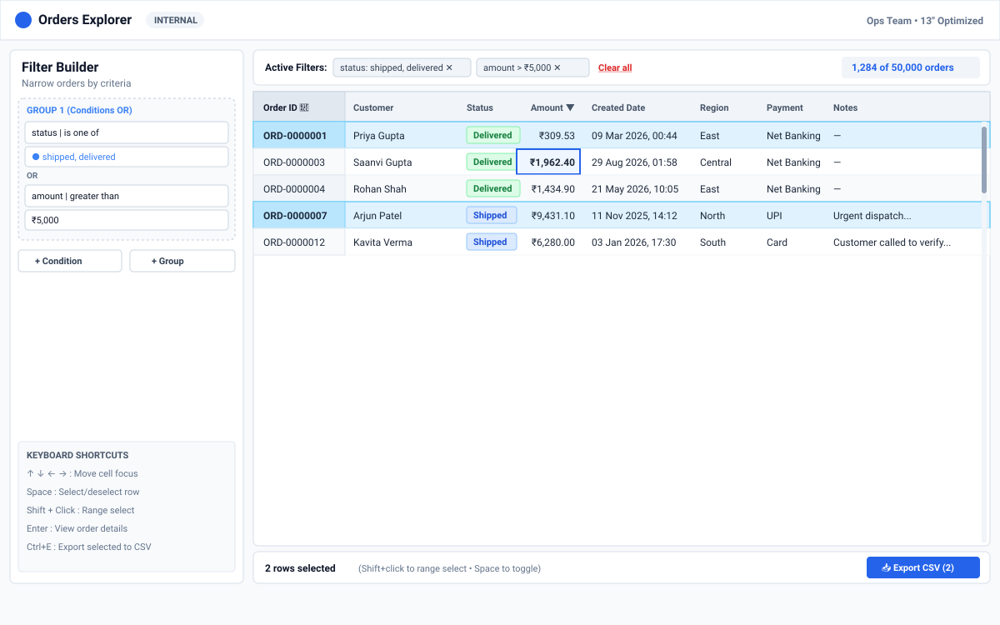
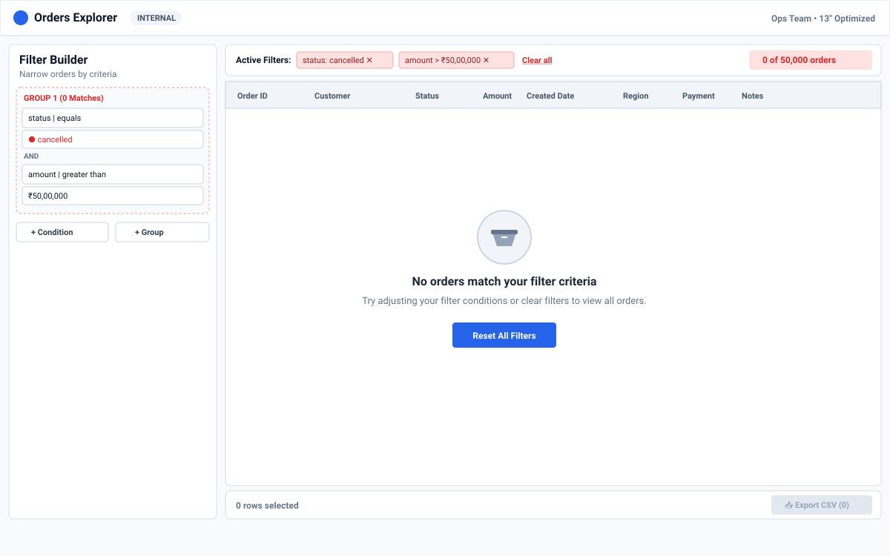

# Orders Explorer

A dense, keyboard-first data grid + filter builder for ~50,000 orders. Built as an internal operations tool optimized for 13-inch laptops.



## How to run

```bash
# 1. Clone
git clone https://github.com/Aadesh-Phadake/ms_assignment.git
cd ms_assignment

# 2. Install
npm install

# 3. Download data (17 MB)
node setup-data.mjs

# 4. Start dev server
npm run dev
```

Open `http://localhost:5173`. The app loads `orders.json` from `public/` via `fetch()`.

## Screenshots

### Main screen with data


### Empty state (zero matching orders)


> **Note:** The SVG wireframes above are the design sketches. The actual app renders with Tailwind CSS styling. Run `npm run dev` to see the live version.

## Dependencies

| Dependency | Why |
|---|---|
| `react`, `react-dom` | Core UI library |
| `tailwindcss`, `@tailwindcss/vite` | Utility-first CSS, fast to build dense layouts |
| `lucide-react` | Clean, consistent icon set (sort arrows, pins, close buttons, filter icons) |
| `date-fns` | Installed for date utilities, but ended up using native `Intl.DateTimeFormat` for display and `Date` constructor for parsing. Kept in case of future use. |

No table library, grid library, virtualization library, or query-builder library is used. The grid and filter builder are built from scratch.

## Data loading

**Choice:** `fetch()` from `public/orders.json` at startup.

**Why:**
- **Not bundled**: Importing a 17 MB JSON file into the JS bundle would bloat the build and slow initial load. `fetch()` keeps it out of the bundle.
- **Cacheable**: The browser caches `orders.json` on subsequent visits.
- **Simple**: No backend or API needed. The file is served as a static asset by Vite.
- **Setup script**: `node setup-data.mjs` downloads the file from the data repo so the 17 MB file doesn't live in git.

All data cleaning (the 10 fixes from `data-notes.md`) happens in `src/utils/dataCleaner.ts` — one file, one pass, before any component sees the data.

## The 200-row question

> A user selects 200 rows. Then they apply a filter that hides 180 of those rows. Then they click Export. What do they get?

**Answer: 20 rows** — only the rows that are both selected AND visible in the current filtered view.

**Why:**
- The user applied a filter to narrow their view. Exporting hidden rows they can't see would be surprising.
- The selection count shown on screen always matches what the export contains. If the status bar says "20 rows selected", export delivers exactly 20.
- This is the least surprising behavior for an operations team that relies on "what I see is what I get."
- The selection count updates live as filters change, so the user always knows what they'll export before clicking.

## Design changes

The final app follows the wireframe layout closely:
- **Filter builder on the left, grid on the right** — as sketched.
- **Filter chips above the grid** — as sketched.
- **Status bar at the bottom** with selection count and export — as sketched.
- **Detail panel on the right** — opens on `Enter` or double-click, closes on `Escape`.

Minor changes from the sketch:
- Added a **URL error banner** at the top (not in the original sketch) to gracefully handle malformed URL params.
- The filter builder uses a slightly more compact layout than sketched to fit more conditions without scrolling.

## Known issues

- **No persistence beyond URL**: Column widths are not saved to URL or localStorage. Refreshing resets them.
- **Large selection in URL**: Selecting many hundreds of rows creates a long URL. Capped at 200 IDs in URL params.
- **Date filtering**: The date inputs use the browser's native `<input type="date">`, which varies in appearance across browsers.
- **No column reordering**: Only pinning is supported, not drag-to-reorder.
- **Performance on very slow machines**: Sorting 50,000 rows is synchronous. On most machines it's under 50ms, but extremely underpowered devices may notice a brief pause.
