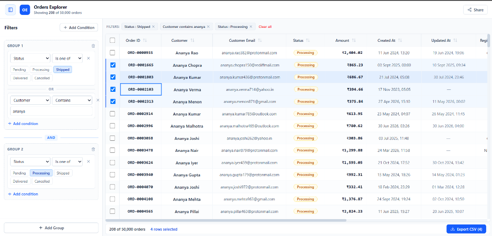
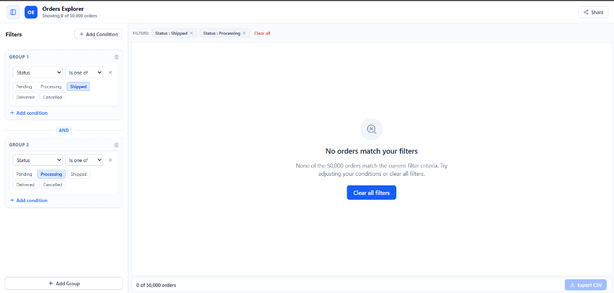

# Orders Explorer

A dense, keyboard-first data grid + filter builder for ~50,000 orders. Built as an internal operations tool optimized for 13-inch laptops.

🔗 **Live Demo:** [https://ms-assignment-delta.vercel.app/](https://ms-assignment-delta.vercel.app/)

---

## Screenshots

### Main screen with active filters & row selection


### Empty state (zero matching orders)


> **Design Wireframes:** The initial design sketches before coding are preserved in the [`design/`](design/) folder (`wireframe-main.svg` and `wireframe-empty.svg`).

---

## How to run

```bash
# 1. Clone
git clone https://github.com/Aadesh-Phadake/ms_assignment.git
cd ms_assignment

# 2. Install (automatically downloads orders.json via postinstall)
npm install

# 3. Manual data download (if needed)
npm run setup

# 4. Start dev server
npm run dev
```

Open `http://localhost:5173`. The app loads `orders.json` from `public/` via `fetch()`.

---

## Dependencies

| Dependency | Why |
|---|---|
| `react`, `react-dom` | Core UI framework |
| `tailwindcss`, `@tailwindcss/vite` | Utility-first styling for dense, high-contrast operations layouts |
| `lucide-react` | Clean icon set for sort arrows, pinning, panel toggle, close buttons, and share |
| `date-fns` | Installed for date utilities, but ended up using native `Intl.DateTimeFormat` for display and `Date` constructor for parsing. Kept in case of future use. |

No table library, grid library, virtualization library, or query-builder library is used. The virtualized grid and filter builder are built 100% from scratch.

---

## Data loading

**Choice:** `fetch()` from `public/orders.json` at startup.

**Why:**
- **Not bundled**: Importing a 17 MB JSON file into the JS bundle would bloat the build and slow initial load. `fetch()` keeps it out of the bundle.
- **Cacheable**: The browser caches `orders.json` on subsequent visits.
- **Simple**: No backend or API needed. The file is served as a static asset by Vite.
- **Setup script**: `node setup-data.mjs` downloads the file from the data repo so the 17 MB file doesn't live in git.

All data cleaning (the 10 fixes from `data-notes.md`) happens in `src/utils/dataCleaner.ts` — one file, one pass, before any component sees the data.

---

## The 200-row question

> A user selects 200 rows. Then they apply a filter that hides 180 of those rows. Then they click Export. What do they get?

**Answer: 20 rows** — only the rows that are both selected AND visible in the current filtered view.

**Why:**
- The user applied a filter to narrow their view. Exporting hidden rows they can't see would be surprising.
- The selection count shown on screen always matches what the export contains. If the status bar says "20 rows selected", export delivers exactly 20.
- This is the least surprising behavior for an operations team that relies on "what I see is what I get."
- The selection count updates live as filters change, so the user always knows what they'll export before clicking.

---

## Design changes

The final application follows the initial wireframe closely with several usability enhancements made during development:
- **Collapsible filter panel**: Added a `[|]` toggle button in the top navigation bar to collapse/expand the filter builder, allowing the grid to take 100% full width when scanning data.
- **Visible header controls**: Sort buttons (`↑↓`) and pin icons (`📌`) are displayed directly on every column header for single-click access without needing context menus.
- **Dedicated checkbox column**: Added a selection column on the far left with a master select-all checkbox header.
- **Centered cell formatting**: Aligned tabular values (Order ID, Customer, Email, Status, Dates, Attributes) to the center for improved scannability on dense screens, while keeping financial amounts right-aligned.
- **Top bar Share button**: Added a 1-click **Share** button with instant feedback to copy the current filtered URL.
- **URL error banner**: Added a non-intrusive warning banner at the top to gracefully handle malformed URL parameters.

---

## Known issues

- **No persistence beyond URL**: Column widths are not saved to URL or localStorage. Refreshing resets them to default widths.
- **Large selection in URL**: Selecting many hundreds of rows creates a long URL string. Capped at 200 IDs in URL params to avoid browser limits.
- **Date filtering**: The date inputs use the browser's native `<input type="date">`, which varies in appearance across operating systems.
- **No column drag-to-reorder**: Column pinning is supported, but freeform drag-and-drop column reordering is not implemented.
- **Performance on very slow machines**: Sorting 50,000 rows is synchronous. On most machines it completes in under 50ms, but low-powered devices may notice a brief pause during initial sort.
